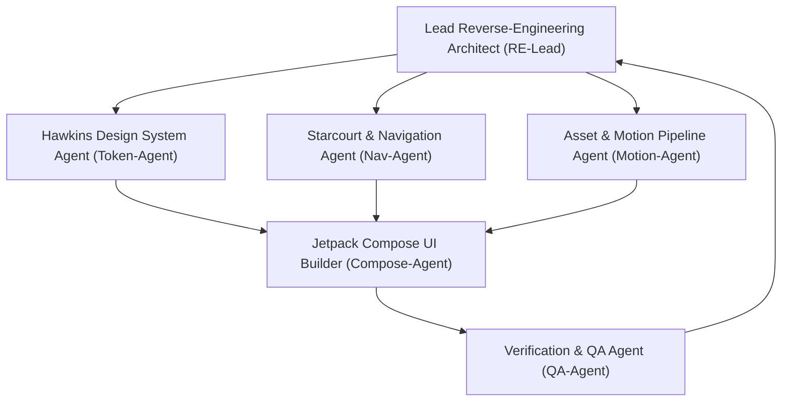

# AGENTS.md — Multi-Agent Operational Guide for Android UI Reverse-Engineering & Reconstruction

## 1. Project Mission & Scope
The mission of this project is to analyze the target Android application packaged as an XAPK (`Netflix_9.87.1+build+9+74620_APKPure`), reverse-engineer all available user interface (UI) data, design tokens, component specifications, screen structures, navigation flows, and interactive micro-animations, and reconstruct a clean,exact same UI modern Android application using **100% Jetpack Compose**, **Kotlin Coroutines / Flow**, and **Material 3 / Hawkins tokens**.

All agents operating in this workspace must adhere to the role descriptions, protocols, and toolchain standards outlined in this document.

---

## 2. Multi-Agent Team Architecture



### Agent 1: Lead Reverse-Engineering Architect (`RE-Lead`)
- **Primary Responsibility**: Master coordination, binary unpacking, split APK identification, manifest decoding, and cross-reference orchestration.
- **Key Tools**: `aapt2`, `apktool`, `jadx`, `tools/extract_xapk.py`, `tools/extract_resources.py`, `tools/extract_manifest_activities.py`, `tools/extract_aapt2_resources.py`.
- **Inputs**: `.xapk` archive, split APK files (`base.apk`, `config.xxhdpi.apk`, `config.en.apk`, etc.).
- **Deliverables**:
  - `manifest_summary.json` (SDK versions, permissions, hardware features, split catalog).
  - `manifest_activities.json` (97 Activity declarations, 12 UI activities, entrypoint deep links, services, receivers).
  - `public_id_map.json` (14,500 public resource ID mappings).
  - `aapt2_resources.json` (AAPT2 resource tables, 13 custom Netflix attributes, 68 button style specifications).
  - `en_strings.json` (3,834 localized English UI strings).

### Agent 2: Hawkins Design System & Token Agent (`Token-Agent`)
- **Primary Responsibility**: Deep reverse-engineering of Netflix's proprietary **Hawkins** design system (`com.netflix.hawkins.consumer.*`), extracting semantic tokens for theming, typography, color palettes, component specifications, and icon systems.
- **Key Tools**: `jadx --single-class`, Python DEX bytecode scanners, `tools/extract_jadx_classes.py`, `tools/extract_hawkins_tokens.py`.
- **Inputs**: `classes*.dex`, decompiled Hawkins classes (`HawkinsTheme`, `Appearance`, `HawkinsButtonType`, `HawkinsButtonSize`, `HawkinsAvatarShape`, `HawkinsTagType`, `HawkinsTagAudioVideoType`, `HawkinsChipType`, `IconSize`).
- **Deliverables**:
  - `jadx_class_analysis.json` (62 classes discovered, 13 priority classes decompiled, verified enums).
  - `hawkins_design_tokens.json`:
    - Themes: `Base` (Dark `#141414`), `Eclipse` (AMOLED Black `#000000`), `Debug`.
    - Appearance: `Dark`, `Light`.
    - Component Contracts:
      - `HawkinsButton`: 6 variants (`Primary`, `Secondary`, `Tertiary`, `Supplemental`, `Brand`, `Destructive`), 3 sizes (`Small` 16dp icon / 32dp height, `Standard` 24dp icon / 40dp height, `Large` 36dp icon / 48dp height).
      - `HawkinsTag`: 4 tag types (`Fill`, `Standard`, `Supplemental`, `Offers`), 2 sizes (`ExtraSmall`, `Small`), 13 AV badge types (`DolbyVision`, `DolbyAtmos`, `SpatialAudio`, `Sdh`, `FourK`, etc.).
      - `HawkinsChip`: 2 types (`Border`, `Borderless`), 2 sizes (`Small`, `Standard`).
      - `HawkinsAvatar`: 2 shapes (`Circle`, `Square`), 5 sizes (`ExtraSmall`, `Small`, `Medium`, `Large`, `ExtraLarge`).
      - `HawkinsDivider`: 2 emphasis levels (`High`, `Low`).
      - `HawkinsIcon`: 4 sizes (`Small`, `Standard`, `Large`, `Jumbo`).
    - Typography Scale: Display (36sp), Title Large/Medium/Small (24/20/16sp), Body Large/Medium/Small (16/14/12sp), Button (14sp Bold), Caption (11sp).

### Agent 3: Starcourt & Navigation Agent (`Nav-Agent`)
- **Primary Responsibility**: Analysis of the app's browsing and screen architecture, specifically the **Starcourt** framework (`com.netflix.starcourt.*`), **Lolomo** ("Lists of Lists of Movies") feed engine, and **Billboard API**.
- **Key Tools**: JADX, DEX scanner, `tools/extract_screens_and_navigation.py`.
- **Inputs**: Manifest activities, Epoxy/MvRx controllers, Billboard CTA classes, ViewModel states.
- **Deliverables**:
  - `screens_and_navigation.json`:
    - 69 Starcourt screen descriptors, 62 Lolomo feed components.
    - 14 Billboard API classes (`PlayCta`, `AddToMyListCta`, `AddToRemindersCta`, `WatchLiveCta`, `NavigateToCollectionCta`, `BillboardPressAction`, `PlaybackPressAction`).
    - 25 Details Page descriptors (including Composable implementations).
    - 50 Games UI descriptors.
    - 4 Bottom Navigation tabs (`Home`, `Games`, `New & Hot`, `My Netflix`).

### Agent 4: Asset & Motion Pipeline Agent (`Motion-Agent`)
- **Primary Responsibility**: Extracting, cataloging, and optimizing all graphic assets, vector drawables, and interactive micro-animations.
- **Key Tools**: `tools/extract_lottie_and_assets.py`, `unzip`, SVG/Vector tools.
- **Inputs**: `assets/lottiefiles/`, `assets/composeResources/`, `icon.png`.
- **Deliverables**:
  - `lottie_catalog.json` indexing 15 Lottie animations:
    - Glowing "N" Logo (`glowing-netflix-n-logo.json`) — Cold start splash screen
    - Play / Pause Morph (`play-pause.json`) — Player control morphing
    - Play / Loading / Replay (`play-loading-replay.json`) — State machine animation
    - "My List" Plus-to-Check Morph (`my-list-plus-to-check.json`) — Watchlist toggle
    - Remind Me Bell (`remind-me-bell-to-check.json`) — Coming soon reminders
    - Rating Thumbs (`rating_thumb_up.json`, `rating_thumb_down.json`, `rating_double_thumb_star_1.json`)
    - Now Playing Equalizer (`now_playing.json`)
  - 49 Hawkins Compose vector drawables in `ui_assets/hawkins_vectors/`.
  - App icon in `ui_assets/app_icon.png`.

### Agent 5: Jetpack Compose UI Builder (`Compose-Agent`)
- **Primary Responsibility**: Translating extracted design tokens, component contracts, navigation graphs, and assets into production-grade Kotlin Jetpack Compose code.
- **Key Tools**: `tools/generate_compose_skeleton.py`, Kotlin compiler / Android Studio MCP.
- **Inputs**: All JSON catalogs from `extraction_output/` and assets from `ui_assets/`.
- **Deliverables**:
  - `generated_app/`:
    - `theme/`: `Color.kt`, `Type.kt`, `Theme.kt` (`HawkinsTheme` implementation with Base & Eclipse support).
    - `components/`: `HawkinsButton.kt` (6 types, 3 sizes), `HawkinsTag.kt`, `BillboardHero.kt`, `LolomoRow.kt`, `NetflixLottieAnimation.kt`.
    - `navigation/`: `AppNavigation.kt` (4 tabs: Home, Games, New & Hot, My Netflix).
    - `screens/`: `HomeScreen.kt`, `SearchScreen.kt`, `DetailsScreen.kt`.
    - Gradle setup (`build.gradle.kts`, `settings.gradle.kts`, `libs.versions.toml`).

### Agent 6: Verification & QA Agent (`QA-Agent`)
- **Primary Responsibility**: Verifying extraction pipelines, confirming schema validity, auditing generated code for compilation readiness, and running regression checks.
- **Key Tools**: `tools/test_pipeline.py`, `run_pipeline.py`.
- **Deliverables**:
  - 11 automated verification tests covering manifest, strings, colors, Hawkins tokens, navigation, Lottie assets, manifest activities, AAPT2 resources, JADX decompilations, Kotlin AST integrity, and Gradle build scripts.

---

## 3. Toolchain & Environment Specifications

| Tool | Version | Executable / Path | Primary Purpose |
|---|---|---|---|
| **JADX** | 1.5.6 | `/usr/bin/jadx` | Targeted decompilation of DEX bytecode into Java/Kotlin code |
| **APKTool** | 3.0.2 | `/usr/bin/apktool` | High-speed resource decoding (`-s` flag skips dex disassembly) |
| **AAPT2** | Android SDK | `/usr/bin/aapt2` | High-fidelity resource table dumping (`aapt2 dump resources`) |
| **Python** | 3.10+ | `/usr/bin/python3` | Extraction, aggregation, parsing, and scaffolding pipelines |
| **REA MCP** | Configured | MCP Server `rea` | Deep static analysis and managed boundary inspection |
| **Ghidra MCP** | Configured | MCP Server `ghidra` | Deep native library analysis (`libnetflix_*.so`) when needed |

---

## 4. Pipeline Execution Protocol

Agents must execute the automated toolchain in sequence or invoke the master runner:

```bash
# 1. Run complete automated extraction and app scaffolding (all 10 stages)
python3 run_pipeline.py

# 2. Or run individual stages modularly:
python3 tools/extract_xapk.py
python3 tools/extract_resources.py
python3 tools/extract_manifest_activities.py
python3 tools/extract_aapt2_resources.py
python3 tools/extract_jadx_classes.py
python3 tools/extract_hawkins_tokens.py
python3 tools/extract_screens_and_navigation.py
python3 tools/extract_lottie_and_assets.py
python3 tools/generate_compose_skeleton.py
python3 tools/test_pipeline.py
```

### Directory Layout
```text
Netflix/
├── AGENTS.md                          # Multi-agent operational guide (this file)
├── README.md                          # Project documentation and quickstart
├── run_pipeline.py                    # Master pipeline orchestrator (10 stages)
├── tools/                             # Extraction & synthesis toolchain
│   ├── extract_xapk.py                # XAPK unpacker & manifest analyzer
│   ├── extract_resources.py           # Resource & string extractor
│   ├── extract_manifest_activities.py # Activity, service, receiver extractor
│   ├── extract_aapt2_resources.py     # AAPT2 resource & custom style extractor
│   ├── extract_jadx_classes.py        # JADX bytecode decompiler & enum analyzer
│   ├── extract_hawkins_tokens.py      # Hawkins design token parser
│   ├── extract_screens_and_navigation.py # Starcourt, Lolomo & Billboard analyzer
│   ├── extract_lottie_and_assets.py   # Lottie & asset cataloger
│   ├── generate_compose_skeleton.py  # Jetpack Compose code generator
│   └── test_pipeline.py               # 11 automated verification tests
├── extraction_output/                 # Clean, structured JSON catalogs & assets
│   ├── manifest_summary.json          # Package metadata, SDK levels, splits
│   ├── en_strings.json                # 3,834 localized strings
│   ├── colors.json                    # Decoded color palette
│   ├── manifest_activities.json       # 97 activities, 12 UI activities
│   ├── aapt2_resources.json           # 13 custom Netflix attrs, 68 button styles
│   ├── jadx_class_analysis.json       # 13 decompiled priority classes & enums
│   ├── hawkins_design_tokens.json     # Hawkins design tokens & component contracts
│   ├── screens_and_navigation.json    # 4 tabs, Lolomo model, Billboard API
│   ├── lottie_catalog.json            # 15 Lottie animations with trigger metadata
│   └── ui_assets/                     # Extracted assets
│       ├── lottiefiles/               # 15 JSON animations
│       ├── hawkins_vectors/           # 49 Compose vector drawables
│       └── app_icon.png               # High-res app icon
└── generated_app/                     # Reconstructed Android Jetpack Compose app
    ├── build.gradle.kts
    ├── settings.gradle.kts
    ├── gradle/libs.versions.toml
    └── app/
        ├── build.gradle.kts
        └── src/main/
            ├── AndroidManifest.xml
            ├── assets/lottie/         # Bundled Lottie animations
            └── java/com/recreated/netflix/
                ├── MainActivity.kt
                ├── theme/             # Color.kt, Type.kt, Theme.kt
                ├── components/        # HawkinsButton.kt, HawkinsTag.kt, BillboardHero.kt, etc.
                ├── navigation/        # AppNavigation.kt (4 tabs)
                └── screens/           # HomeScreen.kt, DetailsScreen.kt, SearchScreen.kt
```

---

## 5. Coding & Clean-Room Standards

1. **Clean-Room Engineering**:
   - Extract **design tokens, metrics, view hierarchies, animations, and layouts**.
   - Do **NOT** copy or extract DRM mechanisms, Widevine keys, media decrypters, or proprietary network encryption logic.
   - All generated Jetpack Compose code must be written as clean, modern Kotlin code adhering to Android Architecture Components best practices.
2. **Design System Loyalty**:
   - Always use `HawkinsTheme.colorScheme` and `HawkinsTheme.typography` rather than hardcoding colors or styles.
   - Support both `Base` (standard dark theme `#141414`) and `Eclipse` (pure OLED black `#000000` background).
   - Use the verified `HawkinsButtonType` (`Primary`, `Secondary`, `Tertiary`, `Supplemental`, `Brand`, `Destructive`) and `HawkinsButtonSize` (`Small`, `Standard`, `Large`).
3. **Micro-Interactions**:
   - Integrate Lottie animations using `com.airbnb.android.lottie:lottie-compose` (`LottieAnimation`, `rememberLottieComposition`, `animateLottieCompositionAsState`).
